# Procesverslag
Markdown is een simpele manier om HTML te schrijven.  
Markdown cheat cheet: [Hulp bij het schrijven van Markdown](https://github.com/adam-p/markdown-here/wiki/Markdown-Cheatsheet).

Nb. De standaardstructuur en de spartaanse opmaak van de README.md zijn helemaal prima. Het gaat om de inhoud van je procesverslag. Besteedt de tijd voor pracht en praal aan je website.

Nb. Door *open* toe te voegen aan een *details* element kun je deze standaard open zetten. Fijn om dat steeds voor de relevante stuk(ken) te doen.

## Jij

  
uitwerken voor kick-off werkgroep

  ### Auteur:
 Jonah Manuel Pieroelie

  #### Je startniveau:
  Blauw

  #### Je focus:
  Responsive
 

## Je website

  
uitwerken voor kick-off werkgroep

  ### Je opdracht:
  link naar de website die je gaat namaken óf de naam/omschrijving van je eigen ontwerp: 

  https://livefastdieyoung.com/en-nlv

  #### Screenshot(s) van de eerste pagina (small screen): 
  hier de naam van de pagina  
  

  #### Screenshot(s) van de tweede pagina (small screen):
  hier de naam van de pagina  
  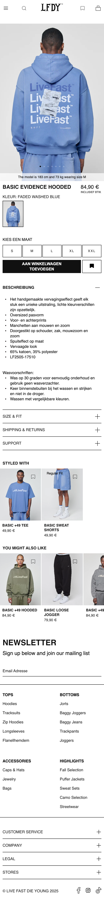
 

## Toegankelijkheidstest 1/2 (week 1)

  
uitwerken na test in 2e werkgroep

  ### Bevindingen
  tijdens het testen van de toegankelijkheid van mijn gekozen site heb ik gebruik gemaakt van de voice over functie die apple aanbiedt. ik heb verschillende pagina's geprobeerd en ik ben gaan kijken wat hier wel en niet goed aan werkt. zo ben ik er achter gekomen wat ik bij mijn eigen versie van de website beter kan maken zodat de website nog toegankelijker is. 

  Lijst met je bevindingen die in de test naar voren kwamen:
  - de afbeeldingen/iconen in de header worden niet duidelijk berschreven. er wordt verteld dat het om een link en een nav gaat maar er wordt niet verteld waar deze nav dan voor dient en waar de gebruiker naar toe gaat als hij/zij hier op klikt. 
  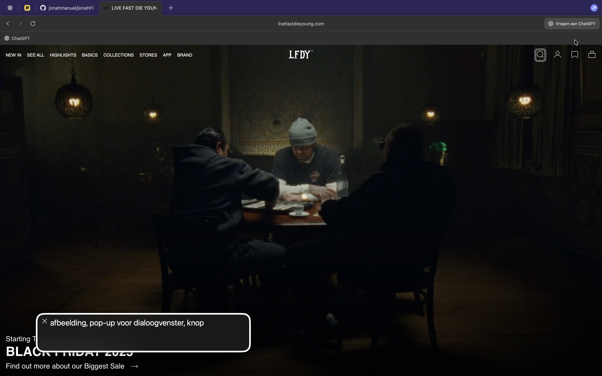
  - zelf vond ik dat de besturing van de voice over tool op de site niet helemaal werkten zoals hij zou moeten. er werd niet aangegeven waar de voice over aan het lezen is en vaak wordt er niet gereageerd op de pijltjes en de tab toetsen. 
  - ook wordt alles wat de voice over voorleest twee keer verteld, de eerste keer in het nederlands en de tweede keer in het duits. dit deed de tool eigenlijk al vanaf het begin en ik heb dit dus niet ingesteld. Ik vind het zelf hierdoor erg onoverzichtelijk worden.
 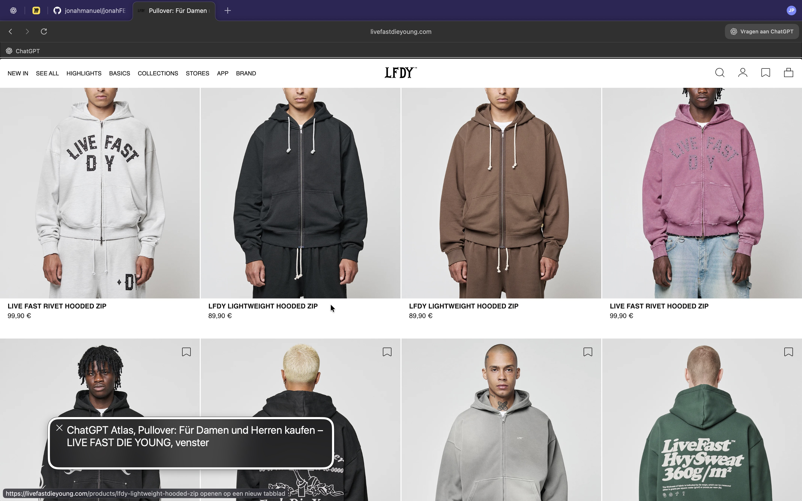

## Breakdownschets (week 1)

  
uitwerken na afloop 3e werkgroep

  ### de hele pagina: 
  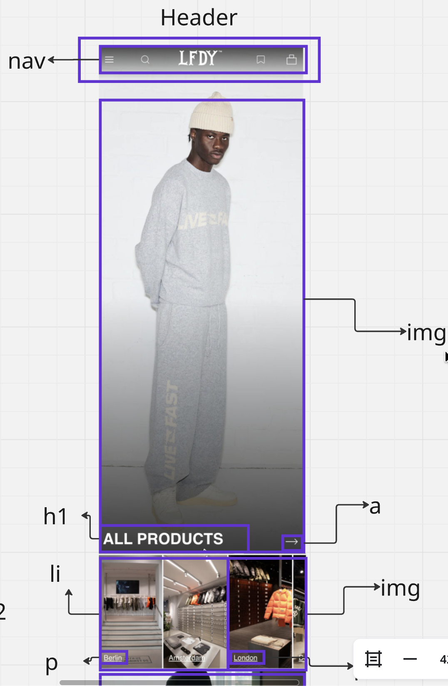

  ### dynamisch deel (bijv menu): 
  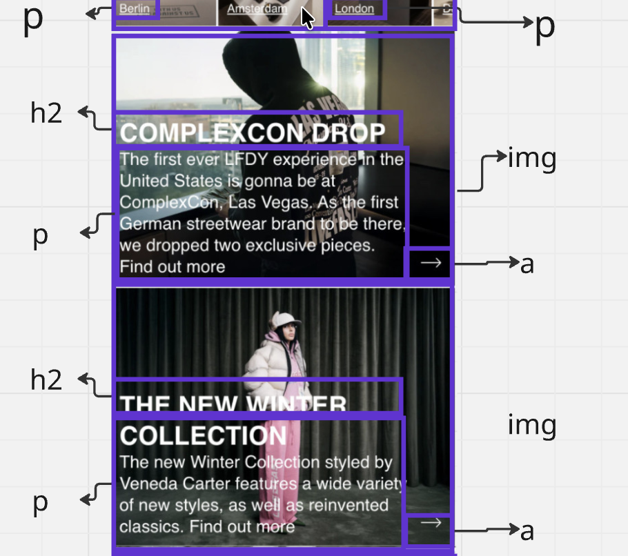

  ### wellicht nog een dynamisch deel (bijv filter): 
  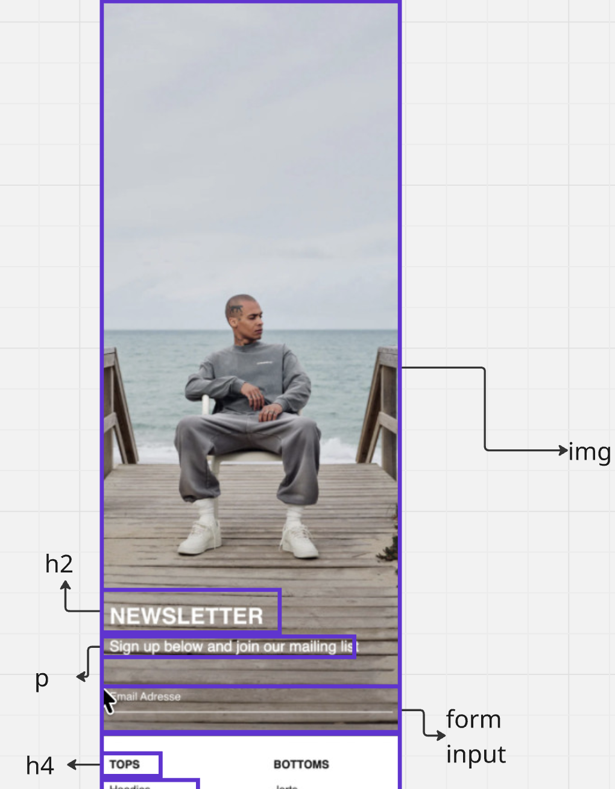

    ### wellicht nog een dynamisch deel (bijv filter): 
  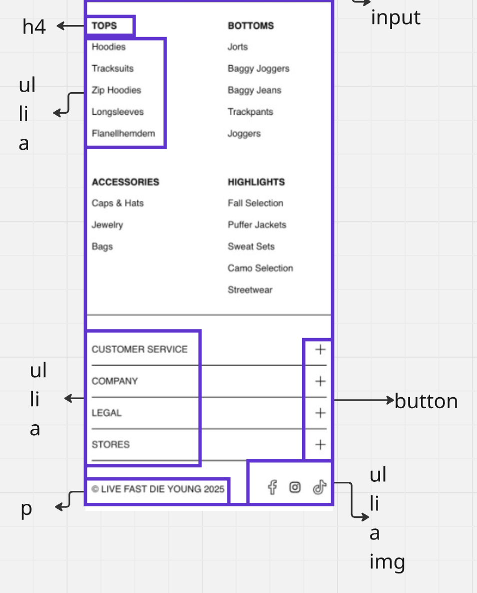

  ### wellicht nog een dynamisch deel (bijv filter): 
  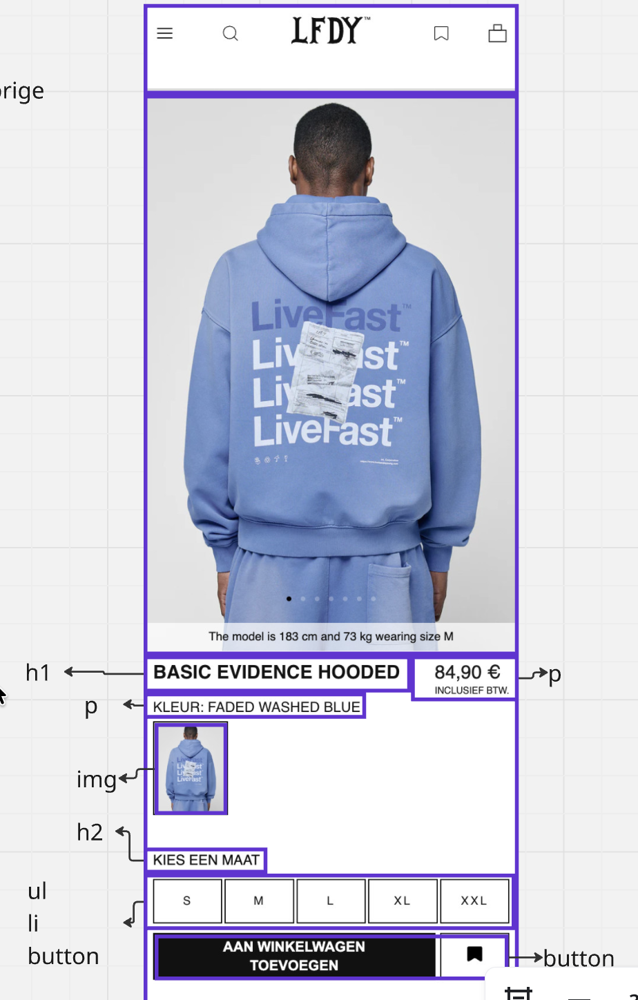

  ### wellicht nog een dynamisch deel (bijv filter): 
  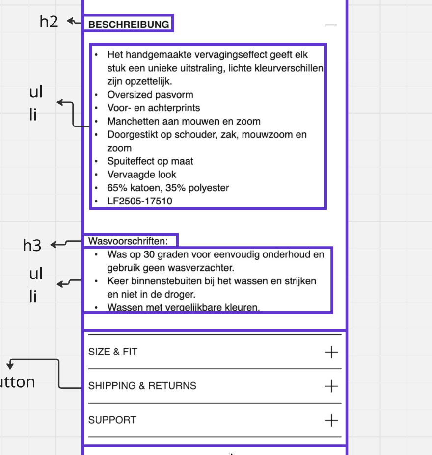

  ### wellicht nog een dynamisch deel (bijv filter): 
  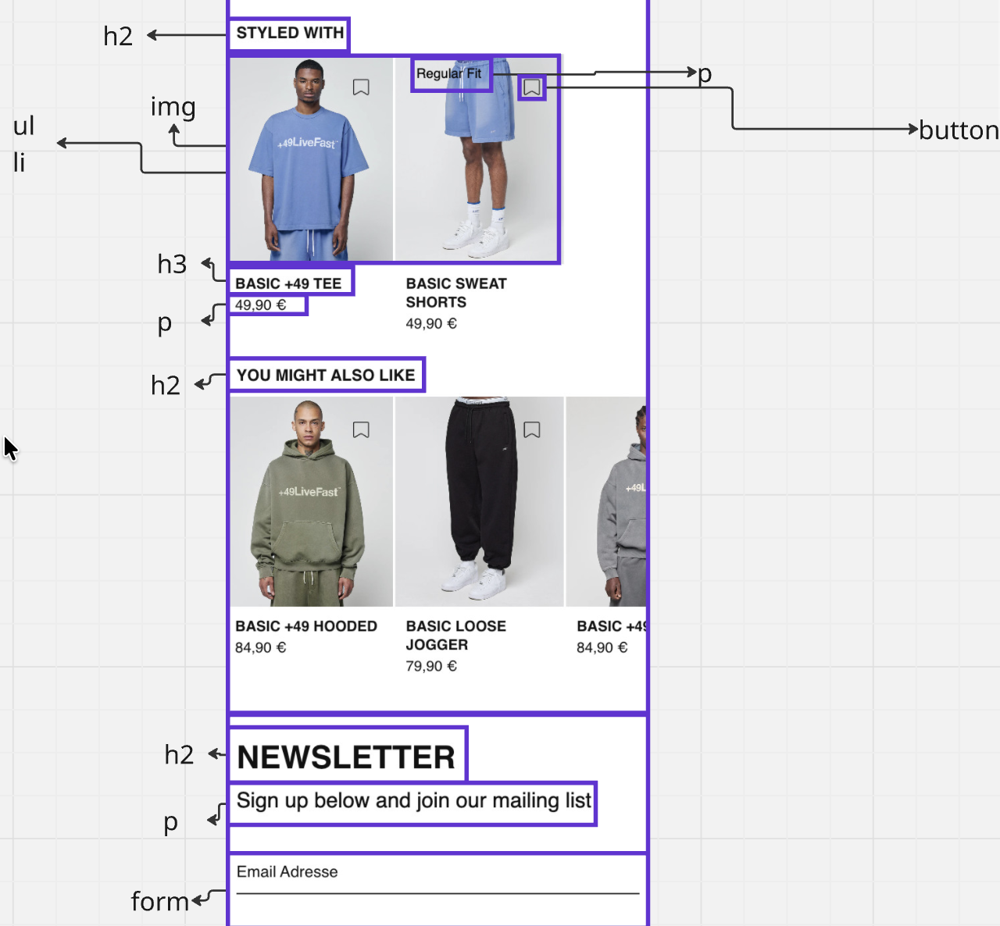

## Voortgang 1 (week 2)

  
uitwerken voor 1e voortgang

  ### Stand van zaken
Ik ben verder gegaan waar ik vorig jaar was gebleven. 

  ### Agenda voor meeting
Het werk dat ik had laten zien.

  ### Verslag van meeting
### Verslag van meeting

Ik heb mijn HTML laten zien en kreeg tips om de productpagina semantischer op te bouwen. Voor Size & Fit, Shipping & Returns en Support kreeg ik het advies om `
` en `
` te gebruiken in plaats van een lijst. Met `
` als klikbare titel kan de gebruiker elk onderdeel openen en sluiten.

## Voortgang 2 (week 3)

  
uitwerken voor 2e voortgang

  ### Stand van zaken
Ik heb de feedback van gesprek 1 toegepast en verder gewerkt aan mijn css. 

  ### Agenda voor meeting
HTML aanpassingen laten checken en css voortgang laten zien. 

  ### Verslag van meeting
Mijn HTML zag er nu goed uit, dus ik kon me richten op de CSS. Ik was vorig jaar al vrij ver met de vormgeving. De belangrijkste feedback was dat mijn media queries onoverzichtelijk waren. Ik kreeg het advies om de regels per schermbreedte bij elkaar te zetten en de breakpoints van klein naar groot te ordenen.

## Toegankelijkheidstest 2/2 (week 4)

  
uitwerken na test in 9e werkgroep

  ### Bevindingen
  Lijst met je bevindingen die in de test naar voren kwamen (geef ook aan wat er verbeterd is):
Ik heb duidelijke alt teksten toegevoegd. op de echte site worden afbeeldingen en iconen niet goed beschreven door de screenreader. Op de echte site krijg je "nav, image, link".
ik heb aria labels toegevoegd voor iconen en knoppen. Op de echte site staat er alleen button. 
Ik heb de focus styles verbeterd voor toetsenbord gebruikers. 
Ik heb een juiste heading structuur gebruikt. 
knoppen en links zijn duidelijk benoemd nu, op de echte site zijn er knoppen zonder tekst. 
De echte site heeft geen light en dark mode. die heb ik nu wel 

## Eindgesprek (week 5)

  
uitwerken voor eindgesprek

  ### Je uitkomst - karakteristiek screenshots:
  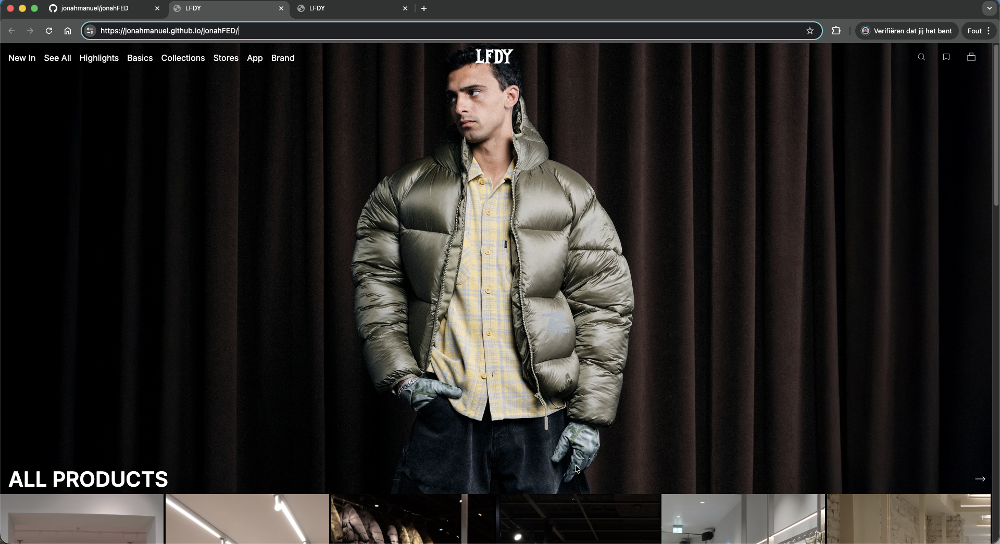\
    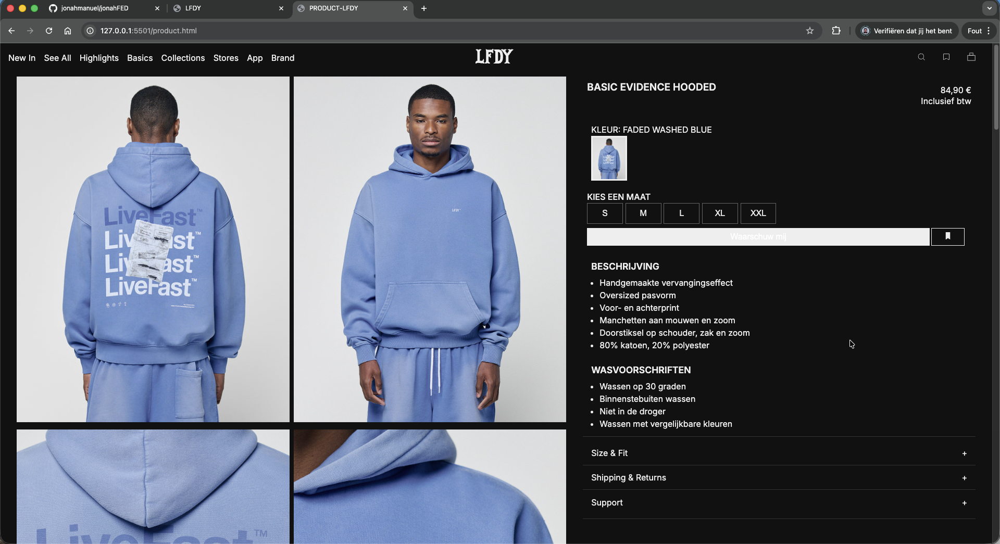

  ### Dit ging goed/Heb ik geleerd: 
### Dit ging goed en dit heb ik geleerd

- Ik heb geleerd om elementen met `:nth-of-type` te selecteren, bijvoorbeeld om de productfoto’s en de productinformatie apart te stylen.
- Ik heb Flexbox gebruikt voor de horizontale fotocarrousel. Vanaf 768 px gebruik ik Grid om de foto’s naast de productinformatie te zetten.
- Ik heb geleerd hoe ik met JavaScript de class `toonMenu` kan toevoegen en weghalen om het hamburgermenu te openen en te sluiten.
- Door met Tab te testen ontdekte ik dat de focus in het gesloten menu buiten beeld kon komen. Ik heb dat opgelost met `visibility: hidden` en de focusrand op fotolinks beter zichtbaar gemaakt.
- Ik heb geleerd hoe ik met `
` en `
` uitklappers kan maken en met CSS een plus of min kan tonen.

  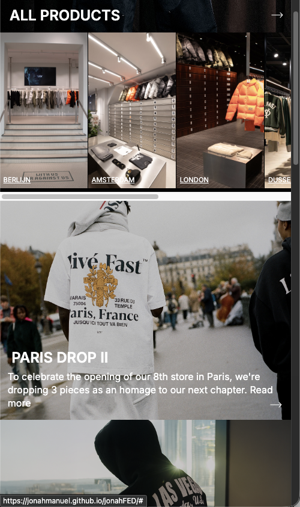

  ### Dit was lastig/Is niet gelukt:
  Korte omschrijving met plaatjes
Het kostte me even om te begrijpen waarom ik met Tab in het gesloten hamburgermenu terechtkwam. Het menu was buiten beeld geschoven, maar de links kregen nog steeds focus. Ik heb de zichtbaarheid aangepast en daarna opnieuw met Tab getest.

Ik vond het lastig om de focusrand op beide pagina’s goed zichtbaar te maken. Op de lichte productpagina viel de witte rand rond de headericonen weg. Ik heb daar een donkere rand ingesteld en bij fotolinks de rand binnen de foto geplaatst.

Ik heb hier geen foto's van want het is uiteindelijk gefixt. 

## Bronnenlijst

Website en beeldmateriaal
- De LFDY-site was mijn voorbeeld voor de homepage en productpagina. De campagnebeelden, winkelfoto’s en productfoto’s komen van die site. LFDY
- Ik heb het lettertype Inter gebruikt. De licentie zit in mijn projectmap bij fonts/Inter-4/LICENSE.txt. Inter
CodePen-voorbeelden
- De basis voor mijn hamburgermenu in shared.css en script.js. Hamburgermenu van shooft https://codepen.io/shooft/pen/myepoJo
- Inspiratie voor de horizontale fotocarrousel op de productpagina. Carrousel van shooft https://codepen.io/shooft/pen/QwjQGZe
Websites

- https://developer.mozilla.org/en-US/docs/Web/CSS/:focus-visible
- https://developer.mozilla.org/en-US/docs/Web/Accessibility/ARIA/Attributes/aria-label
- https://www.a11yproject.com/posts/how-to-hide-content/
- https://stackoverflow.com/questions/9280258/prevent-page-scrolling-when-a-modal-is-open
- https://developer.mozilla.org/en-US/docs/Web/HTML/Reference/Elements/details
- https://developer.mozilla.org/en-US/docs/Web/CSS/Reference/Properties/scroll-snap-type
- https://developer.mozilla.org/en-US/docs/Web/CSS/Reference/At-rules/@media/prefers-color-scheme
AI-hulp
- ChatGPT (OpenAI) hielp me begrijpen waarom het gesloten hamburgermenu nog bereikbaar was met Tab en hoe ik dit met visibility kon aanpassen.
- ChatGPT gaf uitleg en CSS-voorstellen voor de focusrand bij fotolinks en de iconen in de productheader, en voor het contrast van het hamburgericoon in dark mode.
- ChatGPT gaf uitleg en feedback bij onderdelen van mijn CSS, zoals het Grid op de productpagina, de scrollbare kaarten en de plus en min bij de uitklappers.

 

